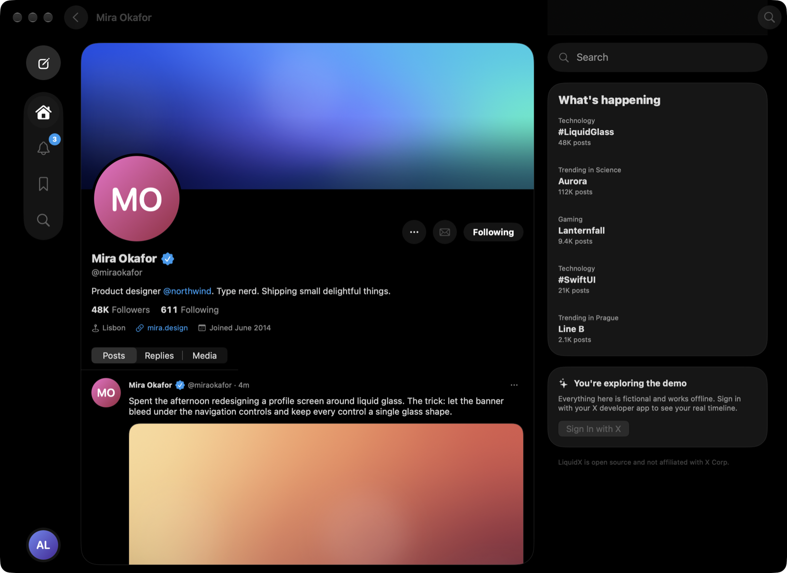
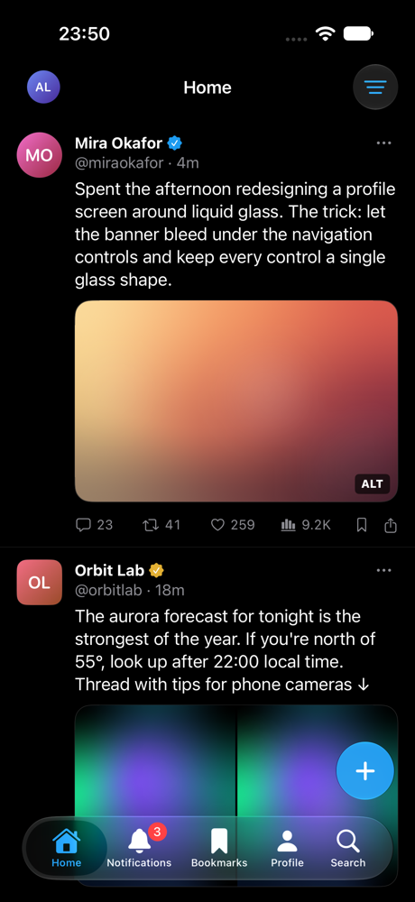
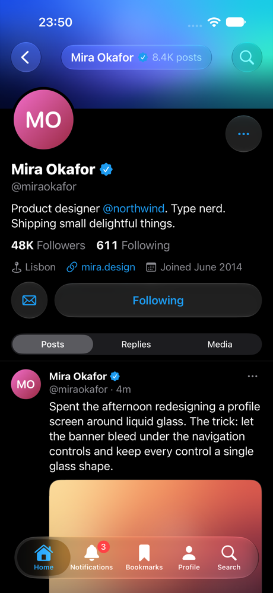
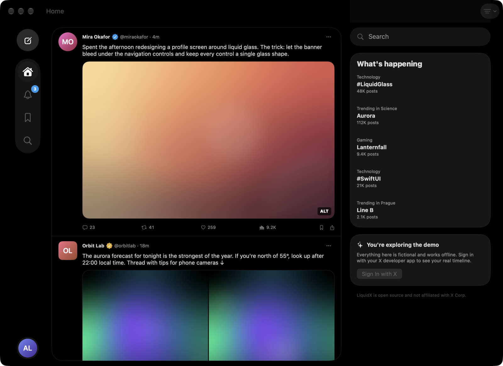

<h1 align="center">LiquidX</h1>

<p align="center">
  <b>A native X client for iPhone, iPad and Mac, built around Liquid Glass.</b><br>
  100% Swift and SwiftUI. No web views, no third-party dependencies.
</p>

<p align="center">
  
  
  
  <a href="LICENSE"></a>
</p>

<p align="center">
  <a href="#features">Features</a> ·
  <a href="#sign-in-with-your-x-developer-app">Sign in</a> ·
  <a href="#build-from-source">Build from source</a> ·
  <a href="#privacy">Privacy</a> ·
  <a href="#status">Status</a>
</p>

<p align="center">
  
</p>

> [!NOTE]
> LiquidX is an independent open-source project. It is not affiliated with,
> endorsed by, or sponsored by X Corp. It talks only to the official X API v2,
> using an X developer app that you create.

## Features

- **Your home timeline**, newest first, with reposts, quotes, link cards, long
  posts, photos, GIFs and video. Filter out replies or reposts.
- **Liquid Glass throughout:** a floating tab bar that shrinks while you scroll on
  iPhone, a glass rail on the Mac, glass profile controls over the banner, and a
  glass media viewer.
- **Profiles** with a stretchy banner, follow/unfollow, and Posts, Replies and
  Media tabs.
- **Like, repost, quote, bookmark, reply and post**, with optimistic updates that
  roll back if X refuses the change.
- **Notifications** (your mentions), **Bookmarks**, **Search** (recent posts,
  hashtags, `from:` queries) and personalized **trends** when your app has access.
- **Fast:** cached timeline on launch, downsampled image decoding off the main
  thread, a bounded memory cache, and refreshes that ask only for posts newer than
  the ones you already have. This also keeps API usage, and cost, low.
- **Native on each platform:** iPhone tabs, an iPad sidebar, and a Mac window
  with menu commands (⌘N new post, ⌘1–5 sections, ⌘R refresh) and a Settings
  window.
- **Demo mode:** explore the whole app offline with fictional accounts. No X
  account is needed.

| iPhone | iPhone profile |
| --- | --- |
|  |  |

<p align="center">
  
</p>

## Sign in with your X developer app

X only lets third-party apps read timelines through the official API, using
an app registered by a developer. LiquidX has no backend and ships no
credentials, so you use your own app:

1. Open the [X Developer Portal](https://developer.x.com/en/portal/dashboard) and
   create a Project and an App.
2. Under **User authentication settings**, enable **OAuth 2.0** and set:
   - **Type of App:** Native App (a public client, so no secret is needed)
   - **App permissions:** Read and write
   - **Callback URI:** `liquidx://oauth-callback`
   - **Website URL:** any URL you control, such as your GitHub profile
3. Copy the **OAuth 2.0 Client ID**.
4. In LiquidX, choose **Set up your X developer app**, paste the Client ID and
   choose **Sign in with X**.

You can also put the Client ID in `Config/Local.xcconfig`
(`LIQUIDX_X_CLIENT_ID = …`) so that your builds come preconfigured.

> [!IMPORTANT]
> X charges for API access, and reads are billed per post returned. Check your
> plan in the Developer Portal. LiquidX loads 40 posts per page and refreshes
> with `since_id`, so pull-to-refresh only reads posts that are new.

Scopes requested: `tweet.read tweet.write users.read like.read like.write
follows.read follows.write bookmark.read bookmark.write offline.access`.

## Build from source

Requirements: Xcode 27 or later, on macOS 26 or later.

```sh
git clone https://github.com/dfrnoch/liquidX.git
cd liquidX
cp Config/Local.xcconfig.example Config/Local.xcconfig   # optional
open LiquidX.xcodeproj
```

Pick the **LiquidX** scheme and a Mac, iPhone simulator or iPad simulator, then
run. Builds for the Mac and the simulator are signed ad hoc, so you don't need
an Apple Developer account for them. To run on a physical device, set
`DEVELOPMENT_TEAM` (and, if needed, `PRODUCT_BUNDLE_IDENTIFIER`) in
`Config/Local.xcconfig`.

To start straight into the demo, enable the `-LiquidXDemo YES` launch argument in
the scheme.

```sh
# Package tests (models, API decoding, OAuth, formatting)
swift test --package-path Packages/LiquidKit

# Build the apps
xcodebuild -project LiquidX.xcodeproj -scheme LiquidX -destination 'platform=macOS' build
xcodebuild -project LiquidX.xcodeproj -scheme LiquidX -destination 'platform=iOS Simulator,name=iPhone 18 Pro' build

# UI tests: walk the demo and attach a screenshot of each screen
xcodebuild -project LiquidX.xcodeproj -scheme LiquidX \
  -destination 'platform=iOS Simulator,name=iPhone 18 Pro' -resultBundlePath build/tour.xcresult test
xcrun xcresulttool export attachments --path build/tour.xcresult --output-path build/tour
```

The architecture is described in [docs/architecture.md](docs/architecture.md).

## Privacy

- LiquidX talks to `api.x.com` and to X's image and video CDNs only. It has no
  analytics, no tracking and no server of its own.
- OAuth tokens are stored only in the Keychain on your device. Sign Out revokes
  the access token with X and deletes the tokens, the cached timeline and your
  cached profile.
- The last 80 posts of your home timeline are cached on disk, so the app opens
  instantly. Images are cached by `URLCache` in the app's Caches folder. You can
  clear both in Settings.

## Status

LiquidX is new and under active development. Things that don't work yet:

- Direct messages: the envelope button opens x.com.
- Media upload in the composer, polls, and editing posts.
- Real-time updates and push notifications. Notifications currently shows mentions.
- Replies on a post page come from recent search, so only replies from the last
  7 days appear.

Contributions are welcome. See [CONTRIBUTING.md](CONTRIBUTING.md).

## License

[MIT](LICENSE). "X" is a trademark of X Corp., used here only to describe
compatibility.
